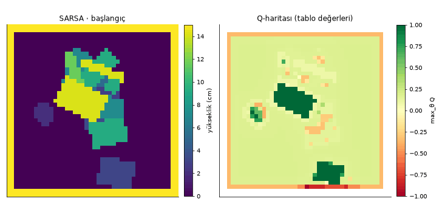

# Düzensiz Kutulardan Parça Alma (Bin Picking) İçin Tablo Tabanlı Pekiştirmeli Öğrenme ile Optimal Kavrama Seçimi

**Pekiştirmeli Öğrenme**
`<Ad Soyad · Öğrenci No · Ders / Dönem>`

> 🎥 Video: `<YOUTUBE_LINKI>` · 💻 Kod: bu depo · 🖥️ Arayüz: `python serve.py` → http://localhost:8000

---

## Özet

Endüstriyel bin picking problemlerinde robot, kutuya rastgele yığılmış parçaları tek tek almalıdır. Yanlış seçilen bir kavrama noktası tutucunun kutu duvarına çarpmasına ya da parçanın tutucudan kayıp düşmesine yol açar. Bu çalışmada problem bir Markov Karar Süreci (MDP) olarak modellendi. Durum, derinlik kamerasından alınan yükseklik haritasıdır; eylem, görüntü koordinatlarındaki kavrama noktası $(x, y)$ ile bilek açısı $\theta$'dır. Ödüller ödev tanımındaki gibidir: başarılı alma $+1$, çarpışma $-1$, başarısız kavrama $-0.2$.

Problem, **derin öğrenme kullanmadan, tablo tabanlı** pekiştirmeli öğrenmeyle çözüldü. Her aday kavrama eylemi, yükseklik haritasından ve robotun kendi hafızasından çıkarılan 7–10 ayrık özelliğe indirgendi (durum-eylem kümeleme). **Q-learning**, **SARSA** ve **Double Q-learning**, sinir ağı olmadan bir Q tablosu öğrenir (parmaklıda 38.880, vakumda 3.456 hücre). Robot, kutuda alınabilir parça kalmadığına karar verince **durabilir**. Tablo değerleri görüntünün her pikseline yerleştirilerek literatürdeki "piksel bazlı Q-haritası" fikri derin öğrenme olmadan elde edildi. Yöntemler, kendi yazdığımız 2.5 boyutlu bir kutu simülasyonunda rastgele seçim, elle yazılmış bir sezgisel kural ve gizli bilgiyi bilen bir **kâhin** (üst sınır) ile karşılaştırıldı. Özellikler, kalan hatalar teşhis edilip kâhinle karşılaştırılarak adım adım seçildi (bölüm 4.1.1).

<!-- OZET:BASLA (run_experiments.py doldurur) -->
**Ana bulgu:** Parmaklı tutucu ile Q-learning, eğitimde görülmemiş test kutularında **%91.5** başarı oranına ulaştı ve en yüksek nokta sezgiselini (%70.6) 20.9 puan farkla geçti; çarpışma oranı %0.0, kutunun %99.8'i boşaltıldı. Rastgele seçimde başarı %3.3, çarpışma %32.4. Gizli bilgiyi bilen kâhin politika %96.6 başarıya ulaşıyor; öğrenen ajan bu üst sınırın **%95**'ine erişti.
<!-- OZET:BITIR -->

Vakumlu tutucuda SARSA **%85.1** başarı oranına ulaştı (sezgisel + yüzey bilgisi %70.2, kâhin %94.4). Ablasyonlar, bu problemde ardışık kararların etkisinin zayıf olduğunu (γ = 0 ≈ γ = 0.5) ve yüksek γ'da Q-learning'in çöküşünü Double Q-learning'in önlediğini (%40.6 → %89.8) gösteriyor.

---

## 1. Giriş ve Endüstriyel Problem

Lojistik ve üretim hatlarında parçalar çoğu zaman kutulara düzensiz biçimde dökülür. Bir robotun bu parçaları alabilmesi için her denemede şu karar verilmelidir: **hangi noktadan ve hangi açıyla tutmalı?**

Kötü bir karar üç tür hataya yol açar:

1. **Çarpışma:** Tutucu kutu duvarına çarpar. Ekipman zarar görebilir, hat durur.
2. **Başarısız kavrama:** Parça tutulamaz. Boş bir noktaya inilir, parmaklar komşu parçaya takılır, parça tutucu açıklığından geniştir ya da üstünde başka parça vardır.
3. **Kayıp düşme:** Parça tutulur ama yanlış açı veya ağırlık merkezinden uzak tutma yüzünden kayar.

Bu kararı elle yazılmış kurallarla vermek zordur, çünkü parçaların şekli, yığılma biçimi ve tutucu geometrisi birlikte etkilidir. Pekiştirmeli öğrenme, ajanın **deneme-yanılma ile** ve yalnızca ödül sinyalini kullanarak iyi kavrama kararlarını öğrenmesini sağlar.

### Neden derin pekiştirmeli öğrenme değil?

Literatürdeki yaygın çözüm, görüntüden doğrudan piksel bazlı Q-haritası üreten tam evrişimli ağlardır (ör. Zeng vd., 2018). Bu çalışmada dersin kapsamına uygun olarak **klasik (tablo tabanlı) pekiştirmeli öğrenme** kullanıldı:

- Öğrenilen model **tamamen yorumlanabilir**: her tablo hücresi "yüksek, düz, duvardan uzak, parmaklar boşta…" gibi okunabilir bir durumu temsil eder.
- GPU gerekmez; eğitim dizüstü bilgisayarda dakikalar sürer.
- Problem yapısının (durum tasarımı, ödül, keşif) etkisi açıkça incelenebilir.

---

## 2. MDP Tasarımı

### 2.1 Durum (State)

Ortamın gerçek durumu, kutunun $44 \times 44$ hücrelik (1 hücre = 1 cm) **yükseklik haritası** $H$ ile tutucu geometrisidir. Ajan haritayı derinlik kamerası gürültüsüyle ($\sigma = 0.05$ cm) görür. Parçaların kimliğini veya konumunu bilmez.

Duruma robotun kendi **hafızası** da eklenir: bu bölümde başarısız kavrama denediği bölgeler. Başarılı bir alım kutuyu değiştirdiği için hafıza o anda silinir. Bu bilgi gizli bir ortam bilgisi değildir; robot kendi denemelerini bilir. Hafıza olmadan durum Markov değildir: kutu değişmediği için ajan aynı başarısız kavramayı tekrar tekrar seçebilir.

### 2.2 Eylem (Action)

$$a = (x, y, \theta), \quad (x, y) \in \text{kutu içi pikseller}, \quad \theta \in \{0°, 45°, 90°, 135°\}$$

Parmaklı tutucuda $\theta$ parmakların kapanma yönüdür. Vakumlu tutucuda (dairesel vantuz) açı etkisizdir, bu yüzden tek açı kullanılır. Her adımda yaklaşık $40 \times 40 \times 4 = 6400$ aday eylem vardır.

Bunlara ek olarak bir **dur** eylemi vardır: robot kutuda alınabilir parça kalmadığına karar verip bölümü bitirir (gerçek bir hücrede kutuyu sallatmak ya da operatöre haber vermek için). Ödevin eylem tanımına yapılan tek eklentidir; olmadığında robot alınamayan parçalar üzerinde bölüm bitene kadar boşa dener.

### 2.3 Ödül (Reward)

| Sonuç | Ödül |
|---|---|
| Parça kutuya çarpmadan ve düşmeden kaldırıldı | $+1$ |
| Tutucu kutu duvarına çarptı | $-1$ |
| Kavrama başarısız (boş nokta, engel, çok geniş parça, üstü kapalı parça, kayıp düşme) | $-0.2$ |
| Dur (bölümü bitir) | $0$ |

### 2.4 Bölüm (Episode)

Her bölümde kutuya 6–14 rastgele parça bırakılır. Bölüm, kutu boşalınca ya da robot durunca (terminal) ya da $\lceil 2.5 \times \text{parça sayısı} \rceil$ deneme yapılınca (kesme) biter. Başarılı her alım yükseklik haritasını değiştirir: alttaki parçalar açığa çıkar. Bu yüzden problem tek adımlık bir sınıflandırma değil, **ardışık bir karar** problemidir.

---

## 3. Simülasyon Ortamı

Fiziksel robot kullanılmadı. Kuşbakışı, 2.5 boyutlu bir kutu simülasyonu sıfırdan yazıldı (`binpick/env.py`):

- **Parçalar:** dikdörtgen kutular (4–14 × 2–8 cm) ve diskler (çap 3–7 cm), kalınlık 2–5 cm. Parçalar kutu merkezinde yığın oluşturacak biçimde sırayla bırakılır. Her parça altındaki en yüksek noktanın üstüne oturur, böylece üst üste binen gerçekçi bir yığın oluşur.
- **Parmaklı tutucu:** 9 cm açıklık, 1 × 3 cm parmaklar. Parmaklar parça üst yüzeyinin 1.5 cm altına inmelidir.
- **Vakumlu tutucu:** 1.5 cm yarıçaplı vantuz. En az %85 sızdırmazlık gerekir.
- **Sonuç kuralları** (ortam gerçek parça bilgisini kullanır):
  1. Tutucu ayak izi duvara değiyorsa → **çarpışma**
  2. Noktada parça yoksa → başarısız
  3. Parmaklar inemiyorsa (parça çok geniş ya da komşu parça engel) / vakum sızdırıyorsa → başarısız
  4. Parçanın üstünde başka parça varsa → başarısız
  5. Kavrama kalitesine bağlı bir olasılıkla parça kayar:

$$p_{\text{kayma}} = p_0 + k_a \cdot e \cdot \left(\tfrac{\Delta\theta}{90°}\right)^2 + k_m \cdot d_{\text{merkez}}^2$$

Burada $e$ parçanın uzunluk oranı (disk için 0), $\Delta\theta$ kapanma yönü ile parçanın kısa ekseni arasındaki açı farkı, $d_{\text{merkez}}$ ise kavrama noktasının parçanın merkezine normalize uzaklığıdır.

<!-- Simülasyondan örnek kare: docs/img/ornek_kutu.png -->

---

## 4. Yöntem: Tablo Tabanlı Q-Öğrenme

### 4.1 Durum-eylem kümeleme

Yükseklik haritasının tamamını tabloda tutmak imkânsızdır. Bunun yerine her aday eylem $a = (x, y, \theta)$ için, o noktanın çevresinden **ayrık yerel özellikler** çıkarılır (`binpick/features.py`):

| Özellik | Kovalar | Anlamı |
|---|---|---|
| Yükseklik | 4 | zemin / alçak / orta / yüksek |
| Düzlük | 3 | 3×3 komşulukta yükseklik standart sapması |
| Yakında daha yüksek | 2 | 3 hücre yarıçapta belirgin daha yüksek nokta var mı (üstü kapalı olma riski) |
| Duvar | 3 | tutucu ayak izi duvara değer / yakın / güvenli |
| Parmak boşluğu* | 3 | parmakların ineceği bölge boş / sınırda / dolu |
| Genişlik* | 3 | $\theta$ yönünde ölçülen yüzey genişliği: sığar / sınırda / çok geniş |
| Hizalama* | 3 | $\theta$ yönündeki yüzeyin dik yöndekine oranı: ≤ 0.75 kısa kenardan / ≤ 1 kısmen / > 1 kare ya da uzun kenardan |
| Eksen ortası* | 5 | nokta parçanın uzun ekseni boyunca tam ortada / ortada / kaymış / uca yakın / uçta |
| Sızdırmazlık** | 3 | vantuz altındaki aynı yüzey oranı |
| Yüzeyi kapatan parça | 2 | noktanın üzerinde durduğu düz yüzey (bölütlenmiş, parçanın görünen üst yüzü) kenarında daha yüksek bir yüzeye değiyor mu |
| Önceden denendi | 2 | robot bu bölümde bu bölgede başarısız oldu mu (hafıza; başarılı alımda silinir) |
| Seri başarısızlık** | 4 | robot bu kutuda üst üste kaç kez başarısız oldu (0 / 1 / 2 / 3+); bütün aday eylemler için ortak |

\* parmaklı tutucu, \*\* vakumlu tutucu, işaretsizler ikisi için. Toplam tablo boyutu: parmaklıda $4 \cdot 3 \cdot 2 \cdot 3 \cdot 3 \cdot 3 \cdot 3 \cdot 5 \cdot 2 \cdot 2 = 38880$, vakumluda $4 \cdot 3 \cdot 2 \cdot 3 \cdot 3 \cdot 2 \cdot 2 \cdot 4 = 3456$ hücre.

*Seri başarısızlık* yalnız vakumda kullanılır. Vakumda bazen kutuda vantuzun oturabileceği parça kalmaz; robotun durmayı öğrenmesi gerekir. Ama "alınabilir parça kalmadı" bilgisi yerel değil, kutunun tamamıyla ilgilidir. Yerel özelliklerle ajan bu durumu ayırt edemiyor: bazı eğitimler durmayı öğrendi, bazıları hiç öğrenemedi (tohumlar arası ±10 puan). Üst üste başarısızlık sayısı, robotun kendi gözleminden çıkan küresel bir işarettir ve durmayı her tohumda kararlı hâle getirir. Parmaklıda tabloyu 4 kat büyüttüğü ve orada durmaya nadiren gerek olduğu için kullanılmaz (ön denemede %92.3 → %90.6).

Özellik vektörü tek bir tamsayıya kodlanır, $\phi(s, a) \in \{0, \dots, N-1\}$, ve

$$Q(s, a) \approx Q_{\text{tablo}}[\phi(s, a)].$$

Tüm özellikler evrişim/filtre işlemleriyle tüm pikseller için aynı anda hesaplanır. Bu sinir ağı değildir: filtreler sabittir ve tutucu geometrisinden türetilir, öğrenilen tek şey tablodur. $\max_\theta Q_{\text{tablo}}[\phi(s, (x, y, \theta))]$ değerleri görüntüye yerleştirilince **Q-haritası** elde edilir.

### 4.1.1 Özellikler nasıl seçildi?

İlk sürümde parmaklı tutucu 7 özellikle (1296 hücre) %85.3 başarıya ulaştı. Kalan hatalar incelendi ve ortamın gizli bilgisini bilen bir **kâhin politikayla** üst sınır hesaplandı (%96.6, 200 test kutusu):

1. **Teşhis:** Kalan hataların neredeyse tamamı *kayma*ydı. Kayma olasılığını iki şey belirliyor: parmakların parçanın kısa kenarından sıkması ve noktanın uzun eksende ortada olması. Eski `ortalı` özelliği ortalanmayı yanlış yönde (kapanma yönünde) ölçüyordu. → **Hizalama** ve **eksen ortası** eklendi.
2. **Yan etki:** Kayma %16'dan %5'e indi ama başarı düştü (%56). Ajan artık ortadan ve kısa kenardan tutmaya çalışıyordu, fakat başka bir parçayla uzaktan örtülmüş parçaları ayırt edemiyor ve kutu değişmediği için aynı hatayı tekrarlıyordu. → Vakum için geliştirilen **yüzeyi kapatan parça** özelliği parmaklıya da açıldı, duruma **hafıza** eklendi.
3. **Sonuç:** Üç özellik birlikte %91.5'e çıktı (önce %85.3). Ablasyonda (tek tohum) her biri çıkarılınca başarı düşüyor: yüzey yok %83.8, hizalama yok %89.7, hafıza yok %90.2 (hepsi açık: %91.4). Kazanç tek bir özellikten değil, üçünün birlikte farklı hata türlerini kapatmasından geliyor.
4. **İkinci tur (son sürüm):** Kalan pay yine kâhinle ölçüldü. Parmaklıda hizalama ve ortalanma daha ince kovalara bölündü (ablasyonda kaba kovalar %90.7). Vakumda adımların %30'u, alınabilir parça kalmadığı hâlde yapılan boşa denemelerdi; **dur** eylemi eklendi (dur eylemi olmadan %65.9). Durmayı kararlı öğrenmek için vakuma **seri başarısızlık** özelliği eklendi: o olmadan 3 tohumun bazıları durmayı hiç öğrenemedi (%71.4), onunla %82.0 ± 0.7. Son sürümde parmaklı tutucuda Q-learning **%91.5 ± 0.2** (kâhinin %95'i), vakumda SARSA **%85.1 ± 0.7** ile en iyi sonucu veriyor.
5. **γ ve Double Q-learning:** Hafızayla birlikte γ = 0 (%91.5) varsayılan γ = 0.5 (%91.4) kadar iyi; bu problemde ardışık kararların etkisi zayıf, iyi kavrama seçimi çoğunlukla tek adımlık bir karar. γ = 0.9'da Q-learning çöküyor (%40.6). Aynı ayarda **Double Q-learning %89.8**'e ulaşıyor: çöküşün sebebi, binlerce aday eylem üzerinden alınan max'ın yarattığı aşırı iyimser tahmin (overestimation bias). Varsayılan γ'da Double Q, Q-learning'i geçmiyor (%90.5).

Denenip **işe yaramayan** fikirler de raporlanmıştır: vakum için uzun eksende ortalanma özelliği (etkisiz), hiç ziyaret edilmemiş tablo hücrelerini öğrenme hedefinde dışlamak (iyimser keşfi kestiği için başarıyı %85'ten %79'a düşürdü), daha temkinli bir durma eşiği (tutarlı iyileşme yok) ve parmaklıda seri başarısızlık özelliği (%92.3 → %90.6).

### 4.2 Öğrenme kuralları

**Q-learning** (off-policy):

$$Q[\phi(s,a)] \leftarrow Q[\phi(s,a)] + \alpha \left( r + \gamma \max_{a'} Q[\phi(s', a')] - Q[\phi(s,a)] \right)$$

**SARSA** (on-policy): hedefte $\max_{a'}$ yerine gerçekten seçilen sonraki eylemin değeri $Q[\phi(s', a')]$ kullanılır.

**Double Q-learning** (van Hasselt, 2010): iki tablo $Q_A$ ve $Q_B$ tutulur. Her adımda biri rastgele güncellenir; sonraki durumun en iyi eylemi o tabloyla seçilir, değeri öbür tablodan okunur:

$$Q_A[\phi(s,a)] \leftarrow Q_A[\phi(s,a)] + \alpha \left( r + \gamma\, Q_B\big[\phi(s', \arg\max_{a'} Q_A[\phi(s',a')])\big] - Q_A[\phi(s,a)] \right)$$

Tek tablodaki $\max$ işlemi, gürültülü tahminlerin en büyüğünü seçtiği için değerleri sistematik olarak olduğundan büyük tahmin eder (overestimation bias). Binlerce aday eylem arasında bu etki büyüktür; Double Q-learning bunu azaltır. Eylem seçimi iki tablonun ortalamasıyla yapılır.

**Dur eyleminin değeri** tam olarak bilinir: ödülü 0'dır ve bölümü bitirir, yani $Q(s, \text{dur}) = 0$. Tabloya ek hücre gerekmez. Ajan, en iyi kavramanın değeri $\max_a Q(s,a) < 0$ olduğunda (her deneme zarar beklenirken) durur; öğrenme hedefinde de bir sonraki durumun değeri $\max(\max_{a'} Q(s',a'),\ 0)$ olur.

- Keşif: ε-açgözlü, $\varepsilon$ 1.0'dan 0.05'e 1500 bölümde doğrusal azalır.
- Öğrenme hızı: ziyaret sayısına bağlı, $\alpha = \max(0.01,\ N(\phi)^{-0.6})$.
- İndirim: $\gamma = 0.5$. Bu değer, sonraki parçaları açığa çıkaran alımların değerini hesaba katar.
- Q tablosu sıfırla başlar. Ödüllerin çoğu negatif olduğundan denenmemiş durumlar başta cazip görünür ve bu doğal bir keşif sağlar.

### 4.3 Karşılaştırma yöntemleri

- **Rastgele:** aday eylemlerden düzgün dağılımla seçim (alt sınır).
- **Kâhin (üst sınır):** ajanın göremediği gizli bilgiyi (parça kimlikleri, üstü kapalı parçalar, her kavramanın gerçek kayma olasılığı) kullanır; başarılı olabilecek kavramalar arasında kayma olasılığı en düşük olanı seçer, alınabilir parça kalmayınca durur. Aynı eylem kümesiyle bundan iyisi yapılamaz (`binpick/oracle.py`).
- **Sezgisel (en yüksek nokta):** duvara çarpmayan açılar arasından, en yüksek noktada ölçülen genişliği en küçük açıyı seçer. Endüstride sık kullanılan, elle yazılmış bir kuraldır. Vakumlu tutucuda, ölçülen sızdırmazlığı %85'in üstünde olan en yüksek parça noktasını seçer. Başarısız olduğu noktanın 2 cm yakınını bir daha denemez (başarılı alımda unutur) ve denenmemiş parça noktası kalmayınca durur; bu, öğrenen ajanın hafızası ve dur eyleminin elle yazılmış karşılığıdır.
- **Sezgisel + yüzey bilgisi (yalnız vakum):** aynı kural, ama Q-learning'e verilen *yüzeyi kapatan parça* özelliğini de kullanır: aday noktalar önce üzerinde durdukları düz yüzey daha yüksek bir yüzeye değmeyenlerle sınırlanır (böyle nokta yoksa sezgiselin kuralına dönülür). Öğrenen ajanla aynı bilgiye sahip olduğundan, vakumdaki kazancın öğrenmeden mi yoksa yalnızca ek bilgiden mi geldiğini ayırmaya yarar.

---

## 5. Deney Düzeni

| Parametre | Değer |
|---|---|
| Yöntemler | Rastgele, Sezgisel (vakumda + yüzey bilgisi), Q-learning, SARSA, Double Q-learning, Kâhin (üst sınır) |
| Tutucular | Parmaklı, vakumlu |
| Eğitim | yöntem ve tutucu başına 3 tohum (0, 1, 2) × 3000 bölüm; ε eğitimin ilk yarısında 1.0 → 0.05 |
| Ara değerlendirme | her 250 bölümde 20 kutuda açgözlü (ε = 0) politika |
| Test | eğitimde görülmemiş 200 sabit tohumlu kutu, $\varepsilon = 0$; tüm yöntemler aynı kutularda |
| Ablasyon | Q-learning, parmaklı (tohum 0): γ ∈ {0, 0.5, 0.9}, sabit α, tek bilek açısı, hizalama / yüzey / hafıza özelliklerinin her biri çıkarılarak, kaba kovalar, dur eylemi olmadan, Double Q-learning γ = 0.9; vakum: *yüzeyi kapatan parça* olmadan (3 tohum), hafıza olmadan ve dur eylemi olmadan (tohum 0) |

Bütün deney tek komutla tekrar üretilebilir: `python run_experiments.py --ablation` (bkz. [Kurulum](#kurulum-ve-çalıştırma)).

Ölçütler: **başarı oranı** (başarılı alım / deneme), **çarpışma oranı**, **başarısız kavrama oranı**, **boşaltılan parça oranı** ve bölüm getirisi.

---

## 6. Sonuçlar

<!-- SONUCLAR:BASLA (run_experiments.py doldurur; elle düzenlemeyin) -->
_Bu bölüm `run_experiments.py` tarafından üretildi (2026-10-19). Ayar: 3 tohum × 3000 eğitim bölümü; test: eğitimde görülmemiş 200 kutu, keşif kapalı (ε = 0). ± değerleri tohumlar arası standart sapmadır._

### 6.1 Parmaklı tutucu

| Yöntem | Başarı oranı | Çarpışma oranı | Başarısız kavrama | Boşaltılan parça | Getiri | Adım |
|---|---|---|---|---|---|---|
| Rastgele | %3.3 | %32.4 | %64.3 | %8.4 | -10.24 | 24.68 |
| Sezgisel | %70.6 | %0.0 | %29.4 | %99.8 | 8.80 | 14.68 |
| **Q-learning** (3 tohum) | %91.5 ± 0.2 | %0.0 ± 0.0 | %8.5 ± 0.2 | %99.8 ± 0.2 | 9.54 ± 0.03 | 10.91 ± 0.02 |
| SARSA (3 tohum) | %90.2 ± 0.6 | %0.0 ± 0.0 | %9.8 ± 0.6 | %99.9 ± 0.0 | 9.53 ± 0.03 | 11.11 ± 0.12 |
| Double Q-learning (3 tohum) | %90.5 ± 0.7 | %0.2 ± 0.1 | %9.4 ± 0.7 | %100.0 ± 0.0 | 9.52 ± 0.05 | 11.03 ± 0.15 |
| Kâhin (üst sınır) | %96.6 | %0.0 | %3.4 | %100.0 | 9.72 | 10.19 |


### 6.2 Vakumlu tutucu

| Yöntem | Başarı oranı | Çarpışma oranı | Başarısız kavrama | Boşaltılan parça | Getiri | Adım |
|---|---|---|---|---|---|---|
| Rastgele | %3.4 | %10.1 | %86.5 | %8.5 | -5.85 | 24.68 |
| Sezgisel | %68.2 | %0.0 | %31.8 | %88.7 | 7.46 | 14.79 |
| Sezgisel + yüzey bilgisi | %70.2 | %0.0 | %29.8 | %90.5 | 7.80 | 14.29 |
| Q-learning (3 tohum) | %82.0 ± 0.7 | %0.1 ± 0.0 | %18.0 ± 0.7 | %89.3 ± 0.7 | 8.31 ± 0.05 | 10.91 ± 0.19 |
| **SARSA** (3 tohum) | %85.1 ± 0.7 | %0.1 ± 0.0 | %14.8 ± 0.7 | %89.0 ± 0.3 | 8.39 ± 0.02 | 10.36 ± 0.09 |
| Double Q-learning (3 tohum) | %80.4 ± 1.7 | %0.1 ± 0.1 | %19.5 ± 1.7 | %89.7 ± 0.2 | 8.30 ± 0.04 | 11.22 ± 0.31 |
| Kâhin (üst sınır) | %94.4 | %0.0 | %5.6 | %90.8 | 8.78 | 9.55 |


### 6.3 Örnek bölümler (aynı kutu, tohum 7)

**Parmaklı tutucu**

| Rastgele | Sezgisel | Q-learning |
|---|---|---|
|  |  |  |

**Vakumlu tutucu**

| Rastgele | Sezgisel | SARSA |
|---|---|---|
|  |  |  |

### 6.4 Ablasyon

**Parmaklı tutucu** (Q-learning, tohum 0)

| Değişiklik | Başarı oranı | Çarpışma oranı | Boşaltılan parça | Getiri |
|---|---|---|---|---|
| γ = 0 (tek adımlık, bandit) | %91.5 | %0.1 | %100.0 | 9.55 |
| γ = 0.5 (varsayılan) | %91.4 | %0.0 | %100.0 | 9.57 |
| γ = 0.9 | %40.6 | %1.8 | %82.4 | 4.96 |
| sabit α = 0.1 | %85.6 | %0.0 | %99.7 | 9.36 |
| tek bilek açısı (θ öğrenilmiyor) | %66.7 | %1.2 | %88.5 | 7.04 |
| hizalama + eksen ortası yok (eski `ortalı`) | %89.7 | %0.0 | %100.0 | 9.53 |
| yüzeyi kapatan parça yok | %83.8 | %0.0 | %99.7 | 9.26 |
| hafıza (önceden denendi) yok | %90.2 | %0.0 | %98.2 | 9.29 |
| kaba kovalar (hizalama 2, eksen ortası 3 kova) | %90.7 | %0.0 | %99.9 | 9.54 |
| dur eylemi yok | %91.4 | %0.0 | %100.0 | 9.57 |
| Double Q-learning, γ = 0.9 | %89.8 | %0.1 | %100.0 | 9.51 |


**Vakumlu tutucu: kazanç öğrenmeden mi, yalnızca ek bilgiden mi?** Sezgisele Q-learning'in gördüğü `yüzey_kapalı` bilgisi verilir (aday noktalar önce üzerinde durdukları düz yüzey daha yüksek bir yüzeye değmeyenlerle sınırlanır); Q-learning de bu özellik olmadan eğitilir.

| Yöntem | Yüzey bilgisi | Q tablosu | Başarı oranı | Çarpışma oranı | Boşaltılan parça | Getiri |
|---|---|---|---|---|---|---|
| Sezgisel | yok | — | %68.2 | %0.0 | %88.7 | 7.46 |
| Sezgisel + yüzey bilgisi | var | — | %70.2 | %0.0 | %90.5 | 7.80 |
| Q-learning (3 tohum) | yok | 1728 hücre | %67.2 ± 4.3 | %0.0 ± 0.0 | %88.6 ± 0.3 | 7.56 ± 0.27 |
| Q-learning (3 tohum) | var | 3456 hücre | %82.0 ± 0.7 | %0.1 ± 0.0 | %89.3 ± 0.7 | 8.31 ± 0.05 |

Yüzey bilgisinin etkisi (başarı oranı, puan): sezgiselde **+1.9**, Q-learning'de **+14.8**. Öğrenmenin aynı bilgiye sahip kurala göre etkisi: yüzey bilgisi olmadan **-1.0** (Q-learning 1728 hücre − sezgisel), yüzey bilgisiyle **+11.8** (Q-learning 3456 hücre − sezgisel + yüzey bilgisi).


<!-- SONUCLAR:BITIR -->

### Yorum

**Öğrenme süreci.** Parmaklı tutucuda ajan rastgele davranışla başlıyor: ilk bölümlerde başarı %5, çarpışma %31. Keşif oranı ε eğitimin ilk yarısında 1.0'dan 0.05'e indikçe başarı neredeyse doğrusal artıyor. Keşifli eğitim politikası, sezgiselin test sonucunu (%70.6) yaklaşık **1.200. bölümde** geçiyor ve ε'nun sabitlendiği 1.500. bölümden sonra %87 civarında duruyor. Çarpışma aynı dönemde %31'den %1.5'e iniyor; kalan %1.5, ε = 0.05 ile yapılan rastgele denemelerden geliyor. Keşif kapatıldığında (test) çarpışma sıfır, başarı %91.5. Üç algoritmanın ve üç tohumun eğrileri neredeyse üst üste biniyor (gölgeli bantlar ±1 std). Vakumda öğrenme daha erken başlıyor: SARSA'nın açgözlü politikası ilk değerlendirmeden itibaren sezgiselle aynı düzeyde ve 1.000. bölümde onu geçiyor. Q-learning ve Double Q ise sezgiseli 1.250. bölüm civarında geçiyor.

**Q tablosu ne öğrendi?** Tablo yöntemi okunabilir olduğu için ajanın öğrendiği kurallar doğrudan görülebiliyor ("ajan ne öğrendi?" grafikleri: her özelliğin her kovası için ziyaret ağırlıklı ortalama Q). Değerler 1'i aşabiliyor, çünkü γ = 0.5 ile sonraki alımların değeri de içeriliyor.
- **Tek negatif kova "duvar = çarpar"** (parmaklıda yaklaşık −0.15, vakumda −0.4). Ajan −1 cezasının nereden geldiğini tam olarak öğrenmiş.
- **Fiziksel sezgiyle uyumlu sıralamalar:** yüksek nokta > alçak > zemin; boş parmak bölgesi (1.55) > dolu (0.3); açıklığa sığan genişlik (1.5) > çok geniş (0.3); eksen ortasında "tam ortada" (1.25) > "uca yakın" (0.7); üstü kapalı yüzey ve önceden denenmiş bölge belirgin biçimde düşük. Vakumda iyi sızdırmazlık (≈1.0) > kötü (≈0).
- **Durma kararı:** vakumda *seri başarısızlık* özelliğinin değeri üst üste başarısızlık arttıkça düzenli düşüyor (0 → 1.25, 3+ → 0.2). Ajan, art arda başarısızlığın "kutuda alınabilir parça kalmadı" işareti olduğunu öğrenmiş; bu, dur eyleminin neden kararlı hâle geldiğini açıklıyor.
- **Beklenmedik bir ayrıntı:** hizalamada "kısmen" kovası (1.3), "kısa kenardan" kovasından (1.0) biraz yüksek. Bu oran iki farklı parça tipini (kare parçalar ve hafif çapraz tutulan uzun parçalar) aynı kovada topluyor. Tablo yönteminin sınırı tam olarak bu: ajan, özelliklerin ayırt ettiğinden fazlasını öğrenemez.

**Algoritmalar ve tutucular.** Parmaklıda üç algoritma arasındaki fark küçük (Q-learning %91.5, Double Q %90.5, SARSA %90.2); farkın büyüklüğü tohumlar arası sapmayla aynı düzeyde. Vakumda SARSA belirgin biçimde önde (%85.1, Q-learning %82.0, Double Q %80.4). Bunun muhtemel sebebi şu: SARSA, keşif dahil gerçekten izlediği politikanın değerini öğrenir ve bu yüzden başarısız denemelerin süreceği durumları daha temkinli değerlendirir. Q-learning'in max hedefi ise devam etmenin değerini iyimser tahmin eder. SARSA kutu başına daha az denemeyle (10.4'e karşı 10.9) aynı oranda parça boşaltıyor (%89.0'a karşı %89.3). Vakum daha zor bir problem: kâhin bile kutunun yalnız %90.8'ini boşaltabiliyor, çünkü 1.5 cm'lik vantuz çok dar parçalara oturamıyor. Öğrenen ajan bu üst sınıra boşaltmada çok yakın (%89–90). Başarı oranında parmaklıda kâhinin %95'ine, vakumda %90'ına ulaşıyor.

**Ablasyon ne gösteriyor?** (Parmaklı satırları tek tohumla ölçüldü; farklar sapmanın birkaç katı olduğunda anlamlıdır.)
- **Bilek açısı en kritik karar:** tek açıyla başarı %91.4'ten %66.7'ye düşüyor (−25 puan).
- **Özellikler arasında en büyük katkı "yüzeyi kapatan parça":** parmaklıda −7.6 puan, vakumda (3 tohum) −14.8 puan. Hizalama (−1.7), hafıza (−1.2) ve ince kovalar (−0.7) daha küçük ama aynı yönde katkı yapıyor.
- **Öğrenme hızı:** sabit α = 0.1 ile %85.6 (−5.8). Ziyaret sayısına bağlı α, binlerce hücreli seyrek tabloda belirgin şekilde daha iyi.
- **γ ve ardışıklık:** γ = 0 (%91.5) ile γ = 0.5 (%91.4) aynı. Bu problemde bir kavramanın sonraki kararlara etkisi zayıf, iyi kavrama seçimi pratikte tek adımlık bir karar. γ = 0.9'da Q-learning çöküyor (%40.6); aynı ayarda Double Q-learning %89.8'e ulaşıyor. Çöküşün sebebi, binlerce aday eylem üzerinden alınan max'ın yarattığı aşırı iyimser tahmin.
- **Dur eylemi:** parmaklıda etkisiz (%91.4, robot hemen hiç takılmıyor), vakumda kritik: dur eylemi olmadan %65.9. Seri başarısızlık özelliği olmadan (3 tohum) %71.4; bazı tohumlar durmayı hiç öğrenemiyor.

---

## 7. Tartışma ve Sınırlamalar

- **Durum tasarımı belirleyicidir.** Tablo yöntemi, ancak seçilen özelliklerin ayırt edebildiği kadarını öğrenebilir. Aynı yükseklikte yan yana duran iki parça yükseklik haritasında tek bir yüzey gibi görünür; bu belirsizlik bilinçli olarak bırakıldı.
- **Kümeleme bir yaklaşıklıktır.** Farklı gerçek durumlar aynı tablo hücresine düşer, bu yüzden Q değerleri bu durumların ortalama başarımını temsil eder.
- **Simülasyon basitleştirilmiştir.** Fizik motoru yoktur; parçalar düz ve rijittir, kayma olasılığı analitik bir modelle verilir. Gerçek bir robota aktarım (sim-to-real) bu çalışmanın kapsamı dışındadır.
- **Ardışık kararların etkisi zayıf.** γ = 0 ile γ = 0.5 aynı sonucu veriyor; ajanın başarısının çoğu, her adımda iyi bir tek kavrama seçmekten geliyor. Kararların gerçekten birbirine bağlı olduğu senaryolar (ör. parçaları itip dağıtmak) bu çalışmanın kapsamı dışında.
- **Kâhine kalan pay:** parmaklıda 5, vakumda 9 puan. Kalan hatalar çoğunlukla kayma; daha ince yönelim ve konum bilgisi tabloyu hızla büyüttüğü için tablo yönteminin pratik sınırına yaklaşılıyor.
- **Dur eyleminin bedeli:** vakumda ajan nadiren, alınabilir bir parça kalmışken durabiliyor. Bu yüzden boşaltma oranı dur eylemi olmayan sürüme göre biraz düşük (%89–90'a karşı %90.5).
- **Ablasyonların çoğu tek tohumla** ölçüldü; 1–2 puanlık farklar tohum değişkenliği içinde kalabilir. Ana sonuçlar ve vakum ablasyonları 3 tohumla raporlandı.
- **Derin RL ile karşılaştırma** yapılmadı; çalışma dersin kapsamına uygun olarak klasik RL ile sınırlı tutuldu.

## 8. Sonuç

Bu çalışmada düzensiz kutudan parça alma problemi bir MDP olarak modellendi ve derin öğrenme kullanmadan, yükseklik haritasından çıkarılan ayrık özellikler üzerinde **tablo tabanlı Q-learning, SARSA ve Double Q-learning** ile çözüldü. Eğitimde görülmemiş 200 test kutusunda öğrenen ajan, parmaklı tutucuda **%91.5** başarı oranına ulaştı (elle yazılmış sezgisel kural %70.6, gizli bilgiyi bilen kâhin üst sınırı %96.6) ve hiç çarpışmadı. Vakumlu tutucuda **%85.1** başarı oranına ulaştı (sezgisel %70.2, kâhin %94.4). En önemli ders, tablo yöntemlerinde başarımın büyük ölçüde **durum tasarımına** bağlı olduğu oldu: kalan hataları teşhis edip kâhinle karşılaştırarak eklenen her özellik (yüzeyi kapatan parça, hizalama, robotun kendi hafızası) belirli bir hata türünü kapattı. Ablasyonlar da bu problemde ardışık kararların etkisinin zayıf olduğunu ve yüksek γ'da Double Q-learning'in aşırı iyimser tahmini düzelttiğini gösterdi.

---

## Etkileşimli Arayüz

Simülasyon ve ajanlar Python'da çalışır; arayüz **React + Three.js** ile yazılmış, gerçekçi bir 3D robot hücresidir:
mavi endüstriyel kutu, metal parçalar, kartezyen (gantry) robot, parmaklı ya da vakumlu tutucu, kutunun üstünde
derinlik kamerası ve alınan parçaların dizildiği tepsi. Her kavrama animasyonla oynatılır: robot hedefe gider, bileği
döndürür, iner, kavrar ve kaldırır. Sonuca göre parça tepsiye taşınır, kayıp düşer ya da tutucu duvara çarpıp sarsılır.

| Sayfa | İçerik |
|---|---|
| 1 · Problem | Endüstriyel problem; dört örnek senaryo 3D olarak oynatılır (başarı, duvar çarpışması, yanlış açı, üstü kapalı parça) |
| 2 · MDP tasarımı | Gerçek sahne ve kameranın gördüğü yükseklik haritası yan yana; dört bilek açısı; ödül ve getiri |
| 3 · Yöntem | Özellik tablosu, her özelliğin tüm piksellerdeki haritası, seçilen eylemin tablo indeksi φ(s,a), öğrenme kuralları, Q-haritası |
| 4 · Simülasyon | Ajanı adım adım ya da otomatik izleme; **manuel mod** (kavrama noktasını kullanıcı seçer); Q-haritasını 3D sahneye yansıtma; ajanın gözünden özellikler |
| 5 · Karşılaştırma | Seçilen yöntemleri aynı test kutularında çalıştırıp grafik ve tablo üretir |
| 6 · Eğitim ve sonuçlar | Tarayıcıdan eğitim başlatma ve canlı öğrenme eğrisi; kayıtlı eğitimlerin eğrileri; "ajan ne öğrendi?" grafikleri |

## Kurulum ve Çalıştırma

```bash
python3 -m venv .venv
source .venv/bin/activate
pip install -r requirements.txt

# arayüzü bir kez derle (Node.js 18+ gerekir)
cd web && npm install && npm run build && cd ..
```

```bash
# testler
pytest -q                 # simülasyon, ajanlar, API
(cd web && npm test)     # arayüz: kavrama animasyonu planı

# TÜM DENEY tek komutla: eğitim → değerlendirme → grafikler → GIF'ler → README (bölüm 6 ve özet)
python run_experiments.py --quick        # önce hızlı deneme (~1-2 dk, results/quick/, README'ye dokunmaz)
python run_experiments.py --ablation     # tam deney (12 eğitim + 8 ablasyon, 10 çekirdekte ~15-30 dk)
python run_experiments.py --skip-train   # eğitim yapmadan raporu yeniden üret
# yarıda kesilirse aynı komut kaldığı yerden devam eder; baştan eğitmek için --force

# tek tek adımlar (isteğe bağlı)
python train.py --algo q_learning --gripper parallel_jaw --episodes 3000
python evaluate.py --runs results/q_learning_parallel_jaw_s0 results/sarsa_parallel_jaw_s0
python plots.py results/q_learning_parallel_jaw_s0 results/sarsa_parallel_jaw_s0
python make_gif.py --run results/q_learning_parallel_jaw_s0 --seed 7 --out results/gifs/qlearning.gif

# etkileşimli arayüz (API + derlenmiş arayüz tek adreste)
python serve.py          # → http://localhost:8000
```

Arayüz üzerinde çalışırken canlı yenileme için iki terminal kullanılır: `python serve.py` ve `cd web && npm run dev`
(→ http://localhost:5173, API istekleri 8000'e yönlendirilir).

Tek tek komutlarda vakumlu tutucu için `--gripper vacuum` kullanılır; `run_experiments.py` iki tutucuyu da çalıştırır.

## Proje Yapısı

```
binpick/
  config.py      tüm parametreler (ortam, tutucu, özellikler, ajan)
  geometry.py    döndürülmüş şekil maskeleri, tutucu ayak izleri
  env.py         kutu simülasyonu ve ödül kuralları
  features.py    yükseklik haritası → ayrık durum-eylem indeksi
  agents.py      Q-learning, SARSA, rastgele, sezgisel
  runner.py      bölüm döngüsü
  training.py    eğitim döngüsü (komut satırı ve arayüz ortak kullanır)
  analysis.py    öğrenilen Q tablosunun yorumu (özellik başına ortalama Q)
  scenarios.py   anlatım için elle kurulmuş örnek kavramalar
  viz.py         matplotlib çizimleri (GIF'ler için)
server/api.py    arayüzün kullandığı HTTP API (FastAPI)
serve.py         API + derlenmiş arayüzü başlatır
web/             React + Three.js arayüzü
  src/three/     3D robot hücresi: sahne, gantry robot, tutucu, kavrama animasyonu
  src/pages/     6 sayfa (Problem, MDP, Yöntem, Simülasyon, Karşılaştırma, Eğitim)
run_experiments.py  tüm deney: çok tohumlu eğitim, değerlendirme, grafikler, GIF, README
train.py         tek eğitim
evaluate.py      test kutularında karşılaştırma
plots.py         öğrenme eğrileri
make_gif.py      bölüm animasyonu
tests/           birim testleri
docs/            video senaryosu, sunum planı, README görselleri
```

## Kaynaklar

1. Sutton, R. S., & Barto, A. G. (2018). *Reinforcement Learning: An Introduction* (2. baskı). MIT Press. — Bölüm 6 (TD öğrenme, Q-learning, SARSA), Bölüm 9.5 (durum kümeleme).
2. Watkins, C. J. C. H., & Dayan, P. (1992). Q-learning. *Machine Learning*, 8(3–4), 279–292.
3. Rummery, G. A., & Niranjan, M. (1994). *On-line Q-learning using connectionist systems*. Cambridge University, Tech. Rep. CUED/F-INFENG/TR 166. (SARSA)
4. Zeng, A., Song, S., Welker, S., Lee, J., Rodriguez, A., & Funkhouser, T. (2018). Learning synergies between pushing and grasping with self-supervised deep reinforcement learning. *IROS*. (Piksel bazlı Q-haritası yaklaşımı)
5. Mahler, J., vd. (2017). Dex-Net 2.0: Deep learning to plan robust grasps with synthetic point clouds and analytic grasp metrics. *RSS*.
