# Düzensiz Kutulardan Parça Alma (Bin Picking) İçin Tablo Tabanlı Pekiştirmeli Öğrenme ile Optimal Kavrama Seçimi

**Ödev 8 · Pekiştirmeli Öğrenme**
`<Ad Soyad · Öğrenci No · Ders / Dönem>`

> 🎥 Video: `<YOUTUBE_LINKI>` · 💻 Kod: bu depo · 🖥️ Arayüz: `python serve.py` → http://localhost:8000

---

## Özet

Endüstriyel bin picking problemlerinde robot, kutuya rastgele yığılmış parçaları tek tek almalıdır. Yanlış seçilen bir kavrama noktası tutucunun kutu duvarına çarpmasına ya da parçanın tutucudan kayıp düşmesine yol açar. Bu çalışmada problem bir Markov Karar Süreci (MDP) olarak modellendi. Durum, derinlik kamerasından alınan yükseklik haritasıdır; eylem, görüntü koordinatlarındaki kavrama noktası $(x, y)$ ile bilek açısı $\theta$'dır. Ödüller ödev tanımındaki gibidir: başarılı alma $+1$, çarpışma $-1$, başarısız kavrama $-0.2$.

Ödevde önerilen tam evrişimli DQN yerine **derin öğrenme kullanmayan, tablo tabanlı** bir yaklaşım geliştirildi. Her aday kavrama eylemi, yükseklik haritasından çıkarılan birkaç ayrık yerel özelliğe indirgendi (durum-eylem kümeleme). **Q-learning** ve **SARSA**, sinir ağı olmadan, birkaç yüz hücrelik bir Q tablosu öğrenir. Tablo değerleri görüntünün her pikseline yerleştirilerek ödevdeki "piksel bazlı Q-haritası" fikri derin öğrenme olmadan elde edildi. Yöntemler, kendi yazdığımız 2.5 boyutlu bir kutu simülasyonunda rastgele ve kural tabanlı (sezgisel) yöntemlerle karşılaştırıldı.

<!-- OZET:BASLA (run_experiments.py doldurur) -->
**Ana bulgu:** Parmaklı tutucu ile Q-learning, eğitimde görülmemiş test kutularında **%85.3** başarı oranına ulaştı ve en yüksek nokta sezgiselini (%69.9) 15.5 puan farkla geçti; çarpışma oranı %0.0, kutunun %99.9'i boşaltıldı. Rastgele seçimde başarı %3.3, çarpışma %32.4.
<!-- OZET:BITIR -->

---

## 1. Giriş ve Endüstriyel Problem

Lojistik ve üretim hatlarında parçalar çoğu zaman kutulara düzensiz biçimde dökülür. Bir robotun bu parçaları alabilmesi için her denemede şu karar verilmelidir: **hangi noktadan ve hangi açıyla tutmalı?**

Kötü bir karar üç tür hataya yol açar:

1. **Çarpışma:** Tutucu kutu duvarına çarpar. Ekipman zarar görebilir, hat durur.
2. **Başarısız kavrama:** Parça tutulamaz. Boş bir noktaya inilir, parmaklar komşu parçaya takılır, parça tutucu açıklığından geniştir ya da üstünde başka parça vardır.
3. **Kayıp düşme:** Parça tutulur ama yanlış açı veya ağırlık merkezinden uzak tutma yüzünden kayar.

Bu kararı elle yazılmış kurallarla vermek zordur, çünkü parçaların şekli, yığılma biçimi ve tutucu geometrisi birlikte etkilidir. Pekiştirmeli öğrenme, ajanın **deneme-yanılma ile** ve yalnızca ödül sinyalini kullanarak iyi kavrama kararlarını öğrenmesini sağlar.

### Neden derin pekiştirmeli öğrenme değil?

Literatürdeki yaygın çözüm, görüntüden doğrudan piksel bazlı Q-haritası üreten tam evrişimli ağlardır (ör. Zeng vd., 2018). Bu çalışmada bilinçli olarak **klasik (tablo tabanlı) pekiştirmeli öğrenme** kullanıldı:

- Öğrenilen model **tamamen yorumlanabilir**: her tablo hücresi "yüksek, düz, duvardan uzak, parmaklar boşta…" gibi okunabilir bir durumu temsil eder.
- GPU gerekmez; eğitim dizüstü bilgisayarda dakikalar sürer.
- Problem yapısının (durum tasarımı, ödül, keşif) etkisi açıkça incelenebilir.

---

## 2. MDP Tasarımı

### 2.1 Durum (State)

Ortamın gerçek durumu, kutunun $44 \times 44$ hücrelik (1 hücre = 1 cm) **yükseklik haritası** $H$ ile tutucu geometrisidir. Ajan haritayı derinlik kamerası gürültüsüyle ($\sigma = 0.05$ cm) görür. Parçaların kimliğini veya konumunu bilmez.

### 2.2 Eylem (Action)

$$a = (x, y, \theta), \quad (x, y) \in \text{kutu içi pikseller}, \quad \theta \in \{0°, 45°, 90°, 135°\}$$

Parmaklı tutucuda $\theta$ parmakların kapanma yönüdür. Vakumlu tutucuda (dairesel vantuz) açı etkisizdir, bu yüzden tek açı kullanılır. Her adımda yaklaşık $40 \times 40 \times 4 = 6400$ aday eylem vardır.

### 2.3 Ödül (Reward)

| Sonuç | Ödül |
|---|---|
| Parça kutuya çarpmadan ve düşmeden kaldırıldı | $+1$ |
| Tutucu kutu duvarına çarptı | $-1$ |
| Kavrama başarısız (boş nokta, engel, çok geniş parça, üstü kapalı parça, kayıp düşme) | $-0.2$ |

### 2.4 Bölüm (Episode)

Her bölümde kutuya 6–14 rastgele parça bırakılır. Bölüm, kutu boşalınca (terminal) ya da $\lceil 2.5 \times \text{parça sayısı} \rceil$ deneme yapılınca (kesme) biter. Başarılı her alım yükseklik haritasını değiştirir: alttaki parçalar açığa çıkar. Bu yüzden problem tek adımlık bir sınıflandırma değil, **ardışık bir karar** problemidir.

---

## 3. Simülasyon Ortamı

Fiziksel robot kullanılmadı. Kuşbakışı, 2.5 boyutlu bir kutu simülasyonu sıfırdan yazıldı (`binpick/env.py`):

- **Parçalar:** dikdörtgen kutular (4–14 × 2–8 cm) ve diskler (çap 3–7 cm), kalınlık 2–5 cm. Parçalar kutu merkezinde yığın oluşturacak biçimde sırayla bırakılır. Her parça altındaki en yüksek noktanın üstüne oturur, böylece üst üste binen gerçekçi bir yığın oluşur.
- **Parmaklı tutucu:** 9 cm açıklık, 1 × 3 cm parmaklar. Parmaklar parça üst yüzeyinin 1.5 cm altına inmelidir.
- **Vakumlu tutucu:** 1.5 cm yarıçaplı vantuz. En az %85 sızdırmazlık gerekir.
- **Sonuç kuralları** (ortam gerçek parça bilgisini kullanır):
  1. Tutucu ayak izi duvara değiyorsa → **çarpışma**
  2. Noktada parça yoksa → başarısız
  3. Parmaklar inemiyorsa (parça çok geniş ya da komşu parça engel) / vakum sızdırıyorsa → başarısız
  4. Parçanın üstünde başka parça varsa → başarısız
  5. Kavrama kalitesine bağlı bir olasılıkla parça kayar:

$$p_{\text{kayma}} = p_0 + k_a \cdot e \cdot \left(\tfrac{\Delta\theta}{90°}\right)^2 + k_m \cdot d_{\text{merkez}}^2$$

Burada $e$ parçanın uzunluk oranı (disk için 0), $\Delta\theta$ kapanma yönü ile parçanın kısa ekseni arasındaki açı farkı, $d_{\text{merkez}}$ ise kavrama noktasının parçanın merkezine normalize uzaklığıdır.

<!-- Simülasyondan örnek kare: docs/img/ornek_kutu.png -->

---

## 4. Yöntem: Tablo Tabanlı Q-Öğrenme

### 4.1 Durum-eylem kümeleme

Yükseklik haritasının tamamını tabloda tutmak imkânsızdır. Bunun yerine her aday eylem $a = (x, y, \theta)$ için, o noktanın çevresinden **ayrık yerel özellikler** çıkarılır (`binpick/features.py`):

| Özellik | Kovalar | Anlamı |
|---|---|---|
| Yükseklik | 4 | zemin / alçak / orta / yüksek |
| Düzlük | 3 | 3×3 komşulukta yükseklik standart sapması |
| Yakında daha yüksek | 2 | 3 hücre yarıçapta belirgin daha yüksek nokta var mı (üstü kapalı olma riski) |
| Duvar | 3 | tutucu ayak izi duvara değer / yakın / güvenli |
| Parmak boşluğu* | 3 | parmakların ineceği bölge boş / sınırda / dolu |
| Genişlik* | 3 | $\theta$ yönünde ölçülen yüzey genişliği: sığar / sınırda / çok geniş |
| Ortalı* | 2 | nokta, yüzeyin ortasında mı |
| Sızdırmazlık** | 3 | vantuz altındaki aynı yüzey oranı |
| Yüzeyi kapatan parça** | 2 | noktanın üzerinde durduğu düz yüzey (bölütlenmiş, parçanın görünen üst yüzü) kenarında daha yüksek bir yüzeye değiyor mu |

\* parmaklı tutucu, \*\* vakumlu tutucu. Toplam tablo boyutu: parmaklıda $4 \cdot 3 \cdot 2 \cdot 3 \cdot 3 \cdot 3 \cdot 2 = 1296$, vakumluda $4 \cdot 3 \cdot 2 \cdot 3 \cdot 3 \cdot 2 = 432$ hücre.

Özellik vektörü tek bir tamsayıya kodlanır, $\phi(s, a) \in \{0, \dots, N-1\}$, ve

$$Q(s, a) \approx Q_{\text{tablo}}[\phi(s, a)].$$

Tüm özellikler evrişim/filtre işlemleriyle tüm pikseller için aynı anda hesaplanır. Bu sinir ağı değildir: filtreler sabittir ve tutucu geometrisinden türetilir, öğrenilen tek şey tablodur. $\max_\theta Q_{\text{tablo}}[\phi(s, (x, y, \theta))]$ değerleri görüntüye yerleştirilince **Q-haritası** elde edilir.

### 4.2 Öğrenme kuralları

**Q-learning** (off-policy):

$$Q[\phi(s,a)] \leftarrow Q[\phi(s,a)] + \alpha \left( r + \gamma \max_{a'} Q[\phi(s', a')] - Q[\phi(s,a)] \right)$$

**SARSA** (on-policy): hedefte $\max_{a'}$ yerine gerçekten seçilen sonraki eylemin değeri $Q[\phi(s', a')]$ kullanılır.

- Keşif: ε-açgözlü, $\varepsilon$ 1.0'dan 0.05'e 1500 bölümde doğrusal azalır.
- Öğrenme hızı: ziyaret sayısına bağlı, $\alpha = \max(0.01,\ N(\phi)^{-0.6})$.
- İndirim: $\gamma = 0.5$. Bu değer, sonraki parçaları açığa çıkaran alımların değerini hesaba katar.
- Q tablosu sıfırla başlar. Ödüllerin çoğu negatif olduğundan denenmemiş durumlar başta cazip görünür ve bu doğal bir keşif sağlar.

### 4.3 Karşılaştırma yöntemleri

- **Rastgele:** aday eylemlerden düzgün dağılımla seçim (alt sınır).
- **Sezgisel (en yüksek nokta):** duvara çarpmayan açılar arasından, en yüksek noktada ölçülen genişliği en küçük açıyı seçer. Endüstride sık kullanılan, elle yazılmış bir kuraldır. Vakumlu tutucuda, ölçülen sızdırmazlığı %85'in üstünde olan en yüksek parça noktasını seçer.
- **Sezgisel + yüzey bilgisi (yalnız vakum):** aynı kural, ama Q-learning'e verilen *yüzeyi kapatan parça* özelliğini de kullanır: aday noktalar önce üzerinde durdukları düz yüzey daha yüksek bir yüzeye değmeyenlerle sınırlanır (böyle nokta yoksa sezgiselin kuralına dönülür). Öğrenen ajanla aynı bilgiye sahip olduğundan, vakumdaki kazancın öğrenmeden mi yoksa yalnızca ek bilgiden mi geldiğini ayırmaya yarar.

---

## 5. Deney Düzeni

| Parametre | Değer |
|---|---|
| Yöntemler | Rastgele, Sezgisel, Sezgisel + yüzey bilgisi (vakum), Q-learning, SARSA |
| Tutucular | Parmaklı, vakumlu |
| Eğitim | yöntem ve tutucu başına 3 tohum (0, 1, 2) × 3000 bölüm; ε eğitimin ilk yarısında 1.0 → 0.05 |
| Ara değerlendirme | her 250 bölümde 20 kutuda açgözlü (ε = 0) politika |
| Test | eğitimde görülmemiş 200 sabit tohumlu kutu, $\varepsilon = 0$; tüm yöntemler aynı kutularda |
| Ablasyon | Q-learning, parmaklı (tohum 0): γ ∈ {0, 0.5, 0.9}, sabit α, tek bilek açısı; vakum (3 tohum): *yüzeyi kapatan parça* özelliği olmadan (216 hücrelik tablo) |

Bütün deney tek komutla tekrar üretilebilir: `python run_experiments.py --ablation` (bkz. [Kurulum](#kurulum-ve-çalıştırma)).

Ölçütler: **başarı oranı** (başarılı alım / deneme), **çarpışma oranı**, **başarısız kavrama oranı**, **boşaltılan parça oranı** ve bölüm getirisi.

---

## 6. Sonuçlar

<!-- SONUCLAR:BASLA (run_experiments.py doldurur; elle düzenlemeyin) -->
_Bu bölüm `run_experiments.py` tarafından üretildi (2026-10-16). Ayar: 3 tohum × 3000 eğitim bölümü; test: eğitimde görülmemiş 200 kutu, keşif kapalı (ε = 0). ± değerleri tohumlar arası standart sapmadır._

### 6.1 Parmaklı tutucu

| Yöntem | Başarı oranı | Çarpışma oranı | Başarısız kavrama | Boşaltılan parça | Getiri | Adım |
|---|---|---|---|---|---|---|
| Rastgele | %3.3 | %32.4 | %64.3 | %8.4 | -10.24 | 24.68 |
| Sezgisel | %69.9 | %0.0 | %30.1 | %98.0 | 8.56 | 14.89 |
| **Q-learning** (3 tohum) | %85.3 ± 0.1 | %0.0 ± 0.0 | %14.7 ± 0.1 | %99.9 ± 0.1 | 9.39 ± 0.01 | 11.79 ± 0.03 |
| SARSA (3 tohum) | %84.2 ± 0.4 | %0.0 ± 0.0 | %15.8 ± 0.4 | %99.9 ± 0.1 | 9.37 ± 0.00 | 11.93 ± 0.02 |

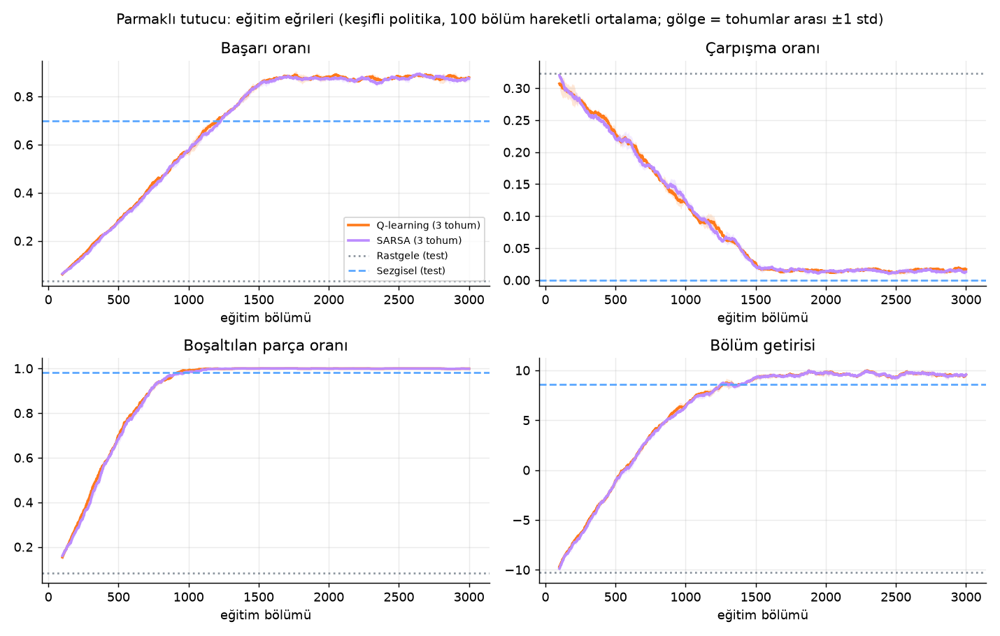

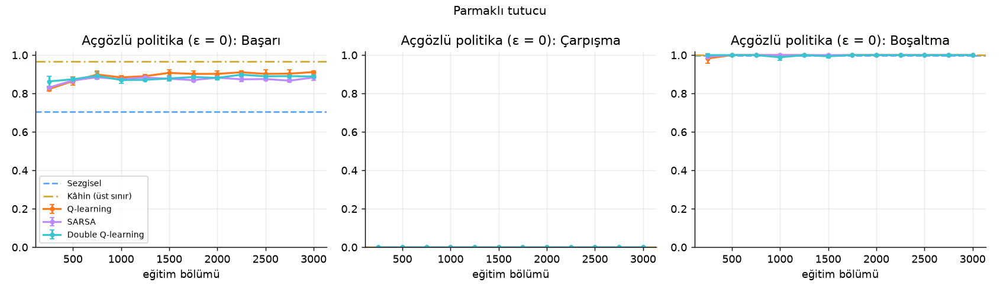

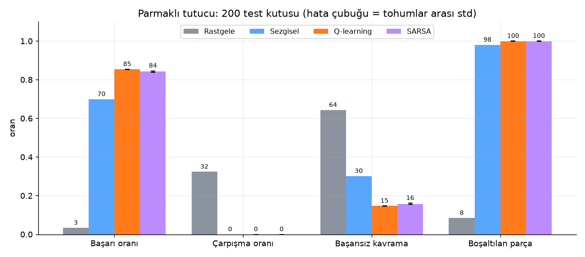

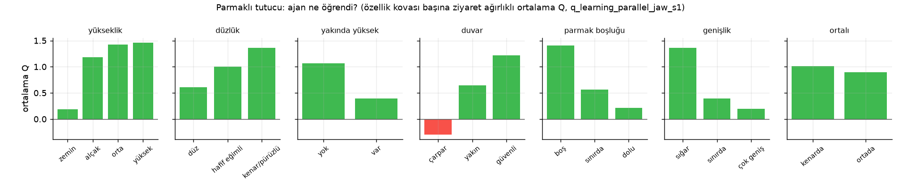

### 6.2 Vakumlu tutucu

| Yöntem | Başarı oranı | Çarpışma oranı | Başarısız kavrama | Boşaltılan parça | Getiri | Adım |
|---|---|---|---|---|---|---|
| Rastgele | %3.4 | %10.1 | %86.5 | %8.5 | -5.85 | 24.68 |
| Sezgisel | %60.6 | %0.0 | %39.4 | %86.0 | 6.61 | 17.19 |
| Sezgisel + yüzey bilgisi | %61.8 | %0.0 | %38.2 | %88.9 | 6.99 | 17.19 |
| **Q-learning** (3 tohum) | %64.3 ± 0.5 | %0.1 ± 0.1 | %35.6 ± 0.5 | %88.4 ± 0.3 | 6.96 ± 0.05 | 16.92 ± 0.09 |
| SARSA (3 tohum) | %64.3 ± 0.3 | %0.0 ± 0.0 | %35.7 ± 0.3 | %88.4 ± 0.3 | 6.99 ± 0.04 | 16.92 ± 0.04 |

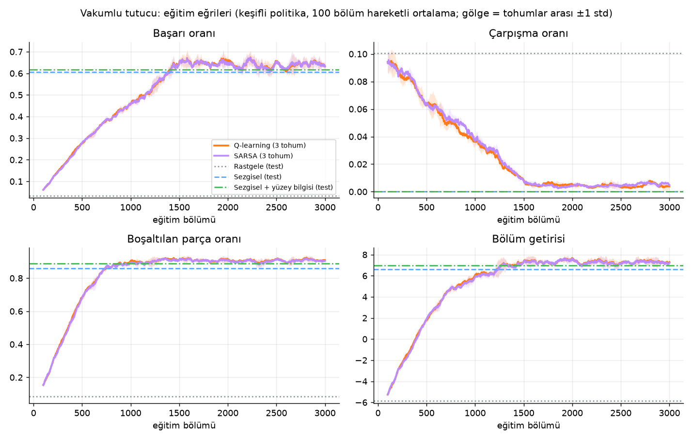

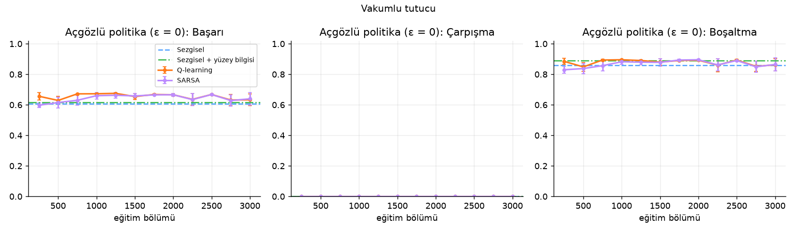

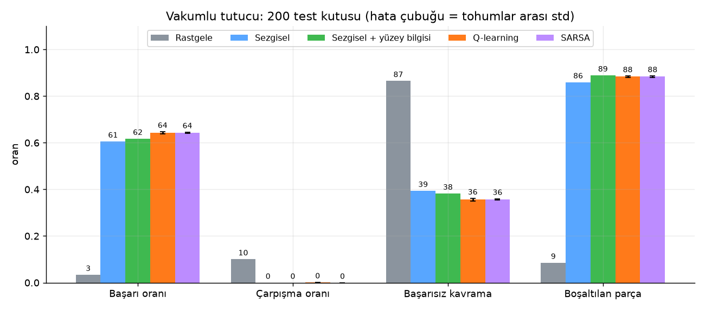

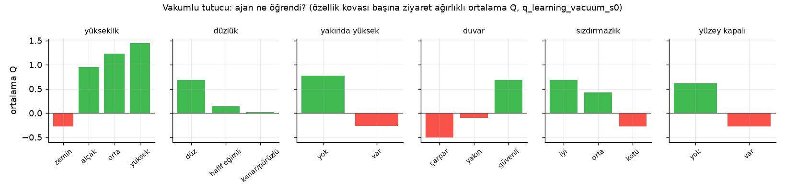

### 6.3 Örnek bölümler (aynı kutu, tohum 7)

**Parmaklı tutucu**

| Rastgele | Sezgisel | Q-learning |
|---|---|---|
|  | 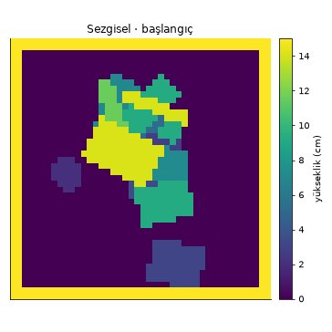 | 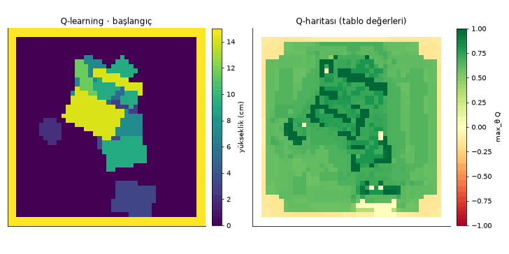 |

**Vakumlu tutucu**

| Rastgele | Sezgisel | Q-learning |
|---|---|---|
|  |  | 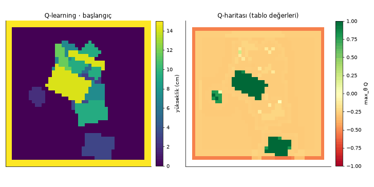 |

### 6.4 Ablasyon

**Parmaklı tutucu** (Q-learning, tohum 0)

| Değişiklik | Başarı oranı | Çarpışma oranı | Boşaltılan parça | Getiri |
|---|---|---|---|---|
| γ = 0 (tek adımlık, bandit) | %31.4 | %0.0 | %47.5 | 0.95 |
| γ = 0.5 (varsayılan) | %85.4 | %0.0 | %99.8 | 9.39 |
| γ = 0.9 | %46.9 | %3.5 | %80.1 | 4.58 |
| sabit α = 0.1 | %53.8 | %0.0 | %68.1 | 4.17 |
| tek bilek açısı (θ öğrenilmiyor) | %47.4 | %0.1 | %71.8 | 4.25 |

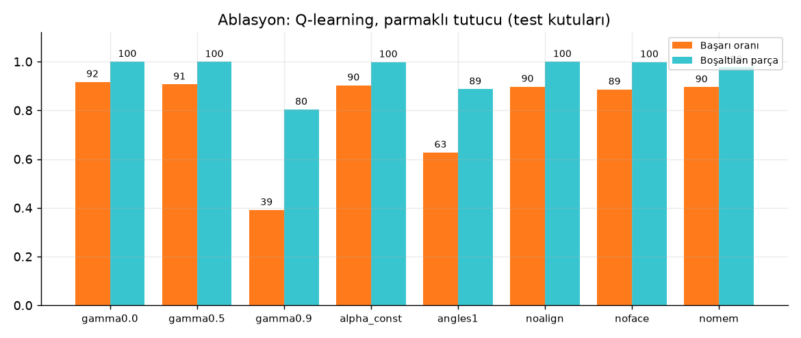

**Vakumlu tutucu: kazanç öğrenmeden mi, yalnızca ek bilgiden mi?** Sezgisele Q-learning'in gördüğü `yüzey_kapalı` bilgisi verilir (aday noktalar önce üzerinde durdukları düz yüzey daha yüksek bir yüzeye değmeyenlerle sınırlanır); Q-learning de bu özellik olmadan eğitilir.

| Yöntem | Yüzey bilgisi | Q tablosu | Başarı oranı | Çarpışma oranı | Boşaltılan parça | Getiri |
|---|---|---|---|---|---|---|
| Sezgisel | yok | — | %60.6 | %0.0 | %86.0 | 6.61 |
| Sezgisel + yüzey bilgisi | var | — | %61.8 | %0.0 | %88.9 | 6.99 |
| Q-learning (3 tohum) | yok | 216 hücre | %51.3 ± 1.8 | %0.1 ± 0.2 | %77.8 ± 0.3 | 5.21 ± 0.04 |
| Q-learning (3 tohum) | var | 432 hücre | %64.3 ± 0.5 | %0.1 ± 0.1 | %88.4 ± 0.3 | 6.96 ± 0.05 |

Yüzey bilgisinin etkisi (başarı oranı, puan): sezgiselde **+1.2**, Q-learning'de **+13.0**. Öğrenmenin aynı bilgiye sahip kurala göre etkisi: yüzey bilgisi olmadan **-9.3** (Q-learning 216 hücre − sezgisel), yüzey bilgisiyle **+2.5** (Q-learning 432 hücre − sezgisel + yüzey bilgisi).

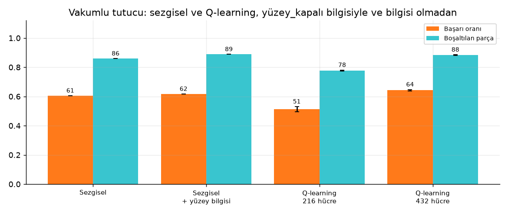
<!-- SONUCLAR:BITIR -->

### Yorum

`<Öğrenme eğrileri: ε azaldıkça başarı oranı nasıl değişti, kaçıncı bölümde sezgisel yöntemi geçti?>`

`<Q tablosu ne söylüyor? "Ajan ne öğrendi?" grafiğinden örnekler: örn. "duvar = çarpar" kovası güçlü negatif, "genişlik = sığar" pozitif.>`

`<Q-learning ve SARSA farkı; parmaklı ve vakumlu tutucu farkı.>`

`<Ablasyon: γ = 0 ile γ > 0 farkı ardışık kararların etkisini gösteriyor mu? Tek açıyla başarım ne kadar düşüyor?>`

---

## 7. Tartışma ve Sınırlamalar

- **Durum tasarımı belirleyicidir.** Tablo yöntemi, ancak seçilen özelliklerin ayırt edebildiği kadarını öğrenebilir. Aynı yükseklikte yan yana duran iki parça yükseklik haritasında tek bir yüzey gibi görünür; bu belirsizlik bilinçli olarak bırakıldı.
- **Kümeleme bir yaklaşıklıktır.** Farklı gerçek durumlar aynı tablo hücresine düşer, bu yüzden Q değerleri bu durumların ortalama başarımını temsil eder.
- **Simülasyon basitleştirilmiştir.** Fizik motoru yoktur; parçalar düz ve rijittir, kayma olasılığı analitik bir modelle verilir. Gerçek bir robota aktarım (sim-to-real) bu çalışmanın kapsamı dışındadır.
- **Derin RL ile karşılaştırma** yapılmadı. Ödev kapsamında bilinçli olarak klasik RL ile sınırlı kalındı.

## 8. Sonuç

`<2-3 cümle: ne yapıldı, ne bulundu, ne öğrenildi.>`

---

## Etkileşimli Arayüz

Simülasyon ve ajanlar Python'da çalışır; arayüz **React + Three.js** ile yazılmış, gerçekçi bir 3D robot hücresidir:
mavi endüstriyel kutu, metal parçalar, kartezyen (gantry) robot, parmaklı ya da vakumlu tutucu, kutunun üstünde
derinlik kamerası ve alınan parçaların dizildiği tepsi. Her kavrama animasyonla oynatılır: robot hedefe gider, bileği
döndürür, iner, kavrar ve kaldırır. Sonuca göre parça tepsiye taşınır, kayıp düşer ya da tutucu duvara çarpıp sarsılır.

| Sayfa | İçerik |
|---|---|
| 1 · Problem | Endüstriyel problem; dört örnek senaryo 3D olarak oynatılır (başarı, duvar çarpışması, yanlış açı, üstü kapalı parça) |
| 2 · MDP tasarımı | Gerçek sahne ve kameranın gördüğü yükseklik haritası yan yana; dört bilek açısı; ödül ve getiri |
| 3 · Yöntem | Özellik tablosu, her özelliğin tüm piksellerdeki haritası, seçilen eylemin tablo indeksi φ(s,a), öğrenme kuralları, Q-haritası |
| 4 · Simülasyon | Ajanı adım adım ya da otomatik izleme; **manuel mod** (kavrama noktasını kullanıcı seçer); Q-haritasını 3D sahneye yansıtma; ajanın gözünden özellikler |
| 5 · Karşılaştırma | Seçilen yöntemleri aynı test kutularında çalıştırıp grafik ve tablo üretir |
| 6 · Eğitim ve sonuçlar | Tarayıcıdan eğitim başlatma ve canlı öğrenme eğrisi; kayıtlı eğitimlerin eğrileri; "ajan ne öğrendi?" grafikleri |

## Kurulum ve Çalıştırma

```bash
python3 -m venv .venv
source .venv/bin/activate
pip install -r requirements.txt

# arayüzü bir kez derle (Node.js 18+ gerekir)
cd web && npm install && npm run build && cd ..
```

```bash
# testler
pytest -q                 # simülasyon, ajanlar, API
(cd web && npm test)     # arayüz: kavrama animasyonu planı

# TÜM DENEY tek komutla: eğitim → değerlendirme → grafikler → GIF'ler → README (bölüm 6 ve özet)
python run_experiments.py --quick        # önce hızlı deneme (~1-2 dk, results/quick/, README'ye dokunmaz)
python run_experiments.py --ablation     # tam deney (12 eğitim + 8 ablasyon, 10 çekirdekte ~15-30 dk)
python run_experiments.py --skip-train   # eğitim yapmadan raporu yeniden üret
# yarıda kesilirse aynı komut kaldığı yerden devam eder; baştan eğitmek için --force

# tek tek adımlar (isteğe bağlı)
python train.py --algo q_learning --gripper parallel_jaw --episodes 3000
python evaluate.py --runs results/q_learning_parallel_jaw_s0 results/sarsa_parallel_jaw_s0
python plots.py results/q_learning_parallel_jaw_s0 results/sarsa_parallel_jaw_s0
python make_gif.py --run results/q_learning_parallel_jaw_s0 --seed 7 --out results/gifs/qlearning.gif

# etkileşimli arayüz (API + derlenmiş arayüz tek adreste)
python serve.py          # → http://localhost:8000
```

Arayüz üzerinde çalışırken canlı yenileme için iki terminal kullanılır: `python serve.py` ve `cd web && npm run dev`
(→ http://localhost:5173, API istekleri 8000'e yönlendirilir).

Tek tek komutlarda vakumlu tutucu için `--gripper vacuum` kullanılır; `run_experiments.py` iki tutucuyu da çalıştırır.

## Proje Yapısı

```
binpick/
  config.py      tüm parametreler (ortam, tutucu, özellikler, ajan)
  geometry.py    döndürülmüş şekil maskeleri, tutucu ayak izleri
  env.py         kutu simülasyonu ve ödül kuralları
  features.py    yükseklik haritası → ayrık durum-eylem indeksi
  agents.py      Q-learning, SARSA, rastgele, sezgisel
  runner.py      bölüm döngüsü
  training.py    eğitim döngüsü (komut satırı ve arayüz ortak kullanır)
  analysis.py    öğrenilen Q tablosunun yorumu (özellik başına ortalama Q)
  scenarios.py   anlatım için elle kurulmuş örnek kavramalar
  viz.py         matplotlib çizimleri (GIF'ler için)
server/api.py    arayüzün kullandığı HTTP API (FastAPI)
serve.py         API + derlenmiş arayüzü başlatır
web/             React + Three.js arayüzü
  src/three/     3D robot hücresi: sahne, gantry robot, tutucu, kavrama animasyonu
  src/pages/     6 sayfa (Problem, MDP, Yöntem, Simülasyon, Karşılaştırma, Eğitim)
run_experiments.py  tüm deney: çok tohumlu eğitim, değerlendirme, grafikler, GIF, README
train.py         tek eğitim
evaluate.py      test kutularında karşılaştırma
plots.py         öğrenme eğrileri
make_gif.py      bölüm animasyonu
tests/           birim testleri
docs/            video senaryosu, sunum planı, README görselleri
```

## Kaynaklar

1. Sutton, R. S., & Barto, A. G. (2018). *Reinforcement Learning: An Introduction* (2. baskı). MIT Press. — Bölüm 6 (TD öğrenme, Q-learning, SARSA), Bölüm 9.5 (durum kümeleme).
2. Watkins, C. J. C. H., & Dayan, P. (1992). Q-learning. *Machine Learning*, 8(3–4), 279–292.
3. Rummery, G. A., & Niranjan, M. (1994). *On-line Q-learning using connectionist systems*. Cambridge University, Tech. Rep. CUED/F-INFENG/TR 166. (SARSA)
4. Zeng, A., Song, S., Welker, S., Lee, J., Rodriguez, A., & Funkhouser, T. (2018). Learning synergies between pushing and grasping with self-supervised deep reinforcement learning. *IROS*. (Ödevde önerilen piksel bazlı Q-haritası yaklaşımı)
5. Mahler, J., vd. (2017). Dex-Net 2.0: Deep learning to plan robust grasps with synthetic point clouds and analytic grasp metrics. *RSS*.
